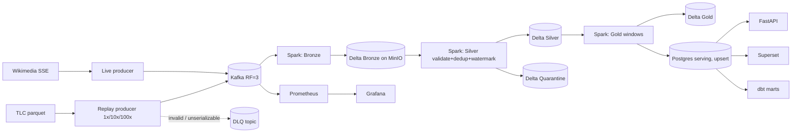

# DEVELOPMENT.md — Real-Time Mobility Intelligence Platform

Status log. Updated after every phase. Nothing is marked done unless it was executed and verified.

## 0. Environment inspection (2026-11-15)

| Item | Finding | Consequence |
|---|---|---|
| Hardware | Apple M1 Pro, 10 cores, 16 GB RAM, 76 GB free disk | Everything must be arm64-compatible |
| Docker | Docker Desktop 24.0.5 / Compose v2.20.2, VM = **5 CPUs / 8 GB** | Full stack does not fit in 8 GB -> Compose **profiles** |
| Java | none on host | Spark runs in containers only; no host `brew install` |
| Python | host 3.10.8; `uv` 0.11 available | Host venv via `uv` (3.12) for unit tests; Spark tests run in container |
| Network | TLC CloudFront, Wikimedia SSE, Citi Bike GBFS all reachable | Real data, real live feed |

## 1. Dataset discovery

Verified on 2026-11-15 by HTTP request, not assumed.

| Candidate | Type | Verified | Format / size | Fit |
|---|---|---|---|---|
| **NYC TLC Yellow Taxi** — https://www.nyc.gov/site/tlc/about/tlc-trip-record-data.page | Historical (monthly, ~2 month lag) | `yellow_tripdata_2024-01.parquet` HTTP 200, 49.9 MB | Parquet, ~2.9M rows/month | Excellent: fares, distance, timestamps, zones, payment -> every DQ rule and Gold metric in scope |
| **NYC TLC Green Taxi** (same page) | Historical | `green_tripdata_2024-01.parquet` HTTP 200, 1.4 MB | Parquet | Same schema family (different column names: `lpep_*`) -> proves schema unification/evolution |
| **Taxi zone lookup** — https://d37ci6vzurychx.cloudfront.net/misc/taxi_zone_lookup.csv | Reference | HTTP 200, 12 KB | CSV | Zone/borough names for geo gold tables |
| **Wikimedia EventStreams `recentchange`** — https://stream.wikimedia.org/v2/stream/recentchange | **Genuinely live** SSE | Received events live (`dt` = 2026-11-15) | JSON over SSE, ~tens of events/s | Real live feed, but not mobility; used as the "live producer" to exercise real-time ingestion, reconnect and `Last-Event-ID` resume |
| **Citi Bike GBFS** — https://gbfs.citibikenyc.com/gbfs/en/station_status.json | **Genuinely live** (polled, not push) | HTTP 200, JSON | JSON snapshot, polled every ~60 s | Mobility-relevant live source (bike/dock availability). Optional second live producer |
| Citi Bike trip history `s3.amazonaws.com/tripdata/` | Historical | Guessed filename returned 404 | CSV zip | Rejected: no fares, so no revenue/DQ-on-money rules |

**License:** TLC states it did not create the data and makes no accuracy guarantees (data comes from TPEP/LPEP vendors). I did **not** find an explicit license text; the NYC Open Data metadata endpoint did not return one either. Treat as public NYC open data, attribute TLC, and re-check terms before any redistribution. Wikimedia event data is public; their API etiquette requires an identifying User-Agent and no hammering.

**Decision:** TLC Yellow + Green (replay) as the core dataset; Wikimedia `recentchange` as the live producer (push SSE, real reconnect semantics). TLC is *not* a live stream: it is replayed at 1x/10x/100x using each row's `tpep_pickup_datetime` as event time. Citi Bike GBFS is a stretch goal.

**Known data traps (will be exercised by DQ rules):** Yellow files contain out-of-range timestamps (e.g. 2002, 2008), negative fares, zero/huge distances, dropoff-before-pickup, nulls in `passenger_count`/`airport_fee`; columns were added in 2025 (`cbd_congestion_fee`) -> real schema evolution.

## 2. Architecture decisions and trade-offs

Resource budget (8 GB Docker VM) drives these:

| Decision | Choice | Trade-off |
|---|---|---|
| Kafka | 3-broker KRaft cluster (combined controller+broker, ~512 MB heap each) to genuinely demo broker failure; RF=3, `min.insync.replicas=2`. `KAFKA_PROFILE=single` gives 1 broker for low-memory machines | 3 brokers cost ~1.5 GB; single broker cannot demo failover |
| Schema | Avro + Confluent Schema Registry, BACKWARD compatibility | Avro in Spark needs `from_avro` + wire-format header stripping (5 bytes) — handled explicitly |
| Table format | Delta Lake (delta-spark) on MinIO via S3A | Delta on S3A has no atomic rename: safe only with a single writer per table. One streaming writer per table by design |
| Exactly-once | Claim only: Kafka -> Delta Bronze is at-least-once source + idempotent sink (Delta `txnAppId` via `foreachBatch`) = effectively-once. Demonstrated with a kill-and-restart test comparing row counts. Postgres serving sink uses upsert on a deterministic key | No cross-system transaction; effectively-once is per-sink, tested not asserted |
| Spark | 1 master + 1 worker (2 cores, ~2 GB), jobs as separate `spark-submit`s (bronze, silver, gold) | Three JVM drivers is expensive; may merge silver+gold behind a flag if memory forces it |
| Airflow | Compose profile `orchestration` (LocalExecutor, own Postgres DB) — batch backfill, compaction (`OPTIMIZE`/`VACUUM`), dbt runs | Not run concurrently with Superset on 8 GB |
| Superset | Compose profile `bi` | Same |
| dbt | `dbt-postgres` on Gold tables synced to Postgres (marts / DQ reports). dbt-spark on Delta is not used (Thrift server = more memory) | Honest scope: dbt covers the serving layer only |
| Observability | Prometheus + Grafana; Kafka JMX/`kafka-exporter` for lag; Spark `StreamingQueryListener` -> metrics; app metrics via `prometheus_client` | |

Data flow:

## 3. Implementation plan (vertical slice first)

| Phase | Scope | Exit criterion (must be demonstrated) |
|---|---|---|
| 1 | Repo scaffold, `uv` venv, compose core (Kafka KRaft x3, Schema Registry, Kafka UI, MinIO), Makefile, `.env.example` | `docker compose ps` all healthy; create topic RF=3 |
| 2 | **Vertical slice:** Avro schema -> replay producer (idempotent, acks=all) -> Spark Bronze -> Delta on MinIO -> row-count check | N events produced == N rows in Bronze |
| 3 | Silver: validation rules, quarantine, dedup w/ watermark, DQ score | Injected bad rows land in quarantine; duplicates dropped |
| 4 | Gold windows (tumbling/sliding), anomalies, Postgres upsert sink | Gold counts match batch recomputation from Silver |
| 5 | FastAPI + health/readiness + JSON logging | curl each endpoint |
| 6 | Prometheus/Grafana, lag exporter, dashboards | Panels show live data (screenshot) |
| 7 | Reliability drills: broker kill, Spark kill, checkpoint recovery, replay, graceful shutdown | Scripted drill, before/after counts |
| 8 | Airflow (backfill, compaction), dbt, Superset | DAG run succeeds; dbt test passes |
| 9 | Pytest: unit / integration / e2e / DQ / recovery / schema-compat; CI | Green locally and in GitHub Actions |
| 10 | Benchmarks, docs, interview Q&A | Numbers measured on this machine, not estimated |

## 4. Progress

- [x] Environment inspected
- [x] Dataset research and verification
- [x] Architecture + plan
- [x] Phase 1: scaffold + core stack (verified 2026-11-15, see section 5)
- [x] Phase 2: vertical slice producer -> Kafka -> Bronze Delta on MinIO (verified, section 5)
- [x] Phase 3: Silver: validation, quarantine, dedup, DQ score/report (verified against independent oracle, section 5)
- [x] Phase 4: Gold windows (tumbling+sliding, watermark) -> Delta MERGE + Postgres upsert; live concurrent run (section 5)
- [x] Phase 5: FastAPI service over Gold (11 endpoints), health/readiness, JSON logs, Prometheus metrics (section 5)
- [x] Phase 6: Prometheus + Grafana + kafka-exporter + app metrics, 3 provisioned dashboards, 8 alerts (section 5, docs/observability.md)
- [ ] Phase 7: reliability drills (broker kill, Spark kill, checkpoint recovery, graceful shutdown)

## 5. Test results

**Phase 1 (executed, passing):**
- `make up` -> kafka-1/2/3, schema-registry, kafka-ui, minio all `Healthy` (`up --wait`).
- Topic `smoke.test` (6 partitions, RF=3): `min.insync.replicas=2`, leaders spread over brokers 1/2/3, ISR full.
- Produce with `acks=all` then consume from beginning: message round-tripped.
- Schema Registry `GET /config` -> `BACKWARD`; Kafka UI `/actuator/health` -> `UP`; MinIO `/minio/health/live` -> 200; buckets `lakehouse`, `checkpoints` exist (`mc ls`).
- Idle memory: brokers ~340 MB each, Kafka UI 286 MB, SR 251 MB, MinIO 204 MB = ~1.76 GB of the 8 GB VM.

**Phase 2 (executed, passing):**
- `pytest tests/unit`: 9 passed (deterministic event IDs, NaN/int-overflow handling, DLQ-bound rows, Avro round-trip, replay clock pacing with a fake clock).
- `make topics`: `trips.raw.v1` (6 partitions, RF=3, min ISR 2), `trips.dlq.v1` (3 partitions).
- `make produce SPEED=0 LIMIT=200000`: sent=200000 acked=200000 failed=0 dlq=0, 6.4 s (~31k events/s, single Python process, idempotent + acks=all + lz4). Schema registered as id 1.
- `make bronze` (availableNow) then `make verify-bronze`: **PASS** — Bronze rows 200000 == Kafka rows 200000 == distinct (topic,partition,offset) 200000 == distinct decoded event_id 200000 (yellow 196229, green 3771). 26 MiB in MinIO.
- Re-running `make bronze` against the same checkpoint added no rows (still PASS).

**Phase 2 gaps closed in Phase 3:** DLQ path and duplicate re-ingestion are now exercised on real data (below).

**Phase 3 (executed, passing):**
- `make test` 9 unit tests + `make test-spark` **28 tests** in the Spark image: every ERROR/WARN rule has a parametrized test (a meta-test fails if a rule lacks one), garbage/wrong-magic/null/truncated/empty payloads, in-batch and cross-batch dedup, retry of the same batch id is idempotent (silver, quarantine, metrics unchanged), all-invalid batch.
- **Bug found by those tests:** `from_avro(..., PERMISSIVE)` returns a struct of all-NULL fields for garbage, not a NULL struct, so my first undecodable check never fired (garbage was only quarantined by accident as `null_fare`). Fixed: a NULL required field (`event_id`/`pickup_ts`) means decode failure.
- **E2E vs independent oracle** (`make e2e-silver`; oracle in `tests/e2e/silver_oracle.py` re-implements the rules in plain Python, shares no code with Spark): 300k replayed rows with injected faults (dup every 50th, poison bytes every 997th, null pickup every 1009th). **ORACLE_RESULT PASS, exact match** on: Bronze rows 305,998; Silver 295,419 (= distinct event_ids); quarantine 4,660 with per-rule counts (negative_fare 4,317, negative_total 4,200, undecodable 300, dropoff_before_pickup 10, implausible_distance 10, pickup_out_of_range 5, trip_too_long 2, implausible_fare 1); warning counts on Silver; duplicates dropped 5,919; DLQ topic offsets 297 = injected null-pickup events. Producer: sent=acked=305,998, failed 0, ~32.8k events/s.
- DQ report generated from the tables: `docs/dq_report.md` (received = quarantined + dup-dropped + inserted reconciles; mean Silver DQ score 0.9906; 92.05% of Silver rows have zero warnings).
- Cross-batch dedup on the live pipeline: replayed the first 5,000 events (same ids) as batch 1 -> 4,922 dropped vs Silver, 4 inserted. The 4 are exactly the events the injector had diverted to the DLQ in the first run (positions 1008/2017/3026/4035), i.e. explained, not noise. Re-running Silver on the drained checkpoint processed 0 batches.

**Phase 4 (executed, passing):**
- `make test-spark`: **38 tests** (was 28). New: each Gold aggregate vs hand-computed values (tumbling, 15m/5m sliding = 3 windows per event, pickup+dropoff zone union with borough join, hourly, 4 outlier types), handler idempotent on batch replay, Spark spec columns == Postgres DDL columns, upsert SQL shape, and the **late-data scenario on real job code and Delta tables** (3 commits: watermark advances to ~12:00; a 2h15m-late event is dropped and the evicted window is untouched; a 20-min-late event within the 30-min watermark is merged).
- **E2E strict (`bash infrastructure/scripts/e2e_gold.sh`)**, 300k replayed rows with injected dup/poison/null faults, availableNow Bronze->Silver->Gold: `GOLD_RESULT PASS` — Delta == Postgres == batch recompute from Silver for all 5 tables (0 missing/extra/mismatch). **Independent oracle (plain Python from the raw parquet, no Spark/Silver) PASS** on 10 measures, incl. 8,289 minute rows, 129,708 zone-window rows; sum of per-minute trips = 295,419 = distinct valid events.
- **Live concurrent run (`bash infrastructure/scripts/live_demo.sh`)**: Bronze, Silver, Gold as three continuous 5 s-trigger Spark drivers while the producer replays 102,000 events at 1000x (125 s, ~815 ev/s) with injected late (200, 3000 events late), duplicate (1,999), poison (100) and null-pickup (99) events, watermark 10 min. Producer sent=acked=102,000. Each driver ~1.2-1.4 GiB of its 2 GiB limit; whole stack fit in the 8 GB VM. Silver oracle PASS on this run too (Bronze 102,000 rows). Gold `--live` verification PASS: Delta == Postgres exactly, no window over-counted or invented, watermark loss visible: sliding 17 events lost / 17 groups dropped, hourly 5 events lost / 2 groups dropped, minute/zone/anomaly 0.
- Serving views work: `gold.v_demand_by_hour_of_day`, `gold.v_demand_anomalies` (|z|>3 vs trailing 60 min; flags the real New-Year-midnight spike, z=40), top pickup zone JFK (20,848 trips in sample). Postgres on host port 5433.

**Bugs/wrong assumptions found while building Phase 4 (all fixed or documented):**
1. *Wrong claim corrected:* I assumed `numRowsDroppedByWatermark` counts dropped events. The live run showed hourly lost 5 events but Spark reported 2. Confirmed by a pinned test: the counter counts **aggregated groups** (lower bound). Exact loss is Silver minus Gold; verifier now requires loss to be *visible* (deficit>0 <=> dropped>0, dropped<=deficit), not equal.
2. Silver and Gold crashed on cold start (`DELTA_SCHEMA_NOT_SET`): streaming from a Delta table whose producer had not written yet. Fixed with `wait_for_delta_table`; the first live attempt exposed it, the second run proves it.
3. py4j errors at Gold shutdown (listener torn down mid-callback): listener removed and Spark stopped in `finally`.
4. Live-demo script hung forever when drivers died; now fails fast with logs.

**Phase 5 (executed, passing):**
- API (`api/`, FastAPI 0.163, port 8000, container `mobility-api`, 256 MB limit, compose healthcheck = `/health/ready`). Endpoints: `/health/live`, `/health/ready`, `/v1/trips/per-minute`, `/v1/demand/{sliding,hourly,by-hour-of-day}`, `/v1/zones/top`, `/v1/zones/{id}/trend`, `/v1/anomalies/{counts,demand}`, `/v1/pipeline/status`, `/metrics`. OpenAPI at `/docs`.
- Security/robustness: read-only Postgres role `api_ro` (verified: SELECT ok, DELETE denied), parameterized SQL + whitelisted table names, enum/range-validated params (422), bounded `limit`, `statement_timeout` 5 s, 503 + `Retry-After` on DB outage, process stays alive and `/health/live` stays 200 while `/health/ready` is 503.
- `make test` (9) + `make test-api` (**29 integration tests**, real throwaway Postgres DB with the real DDL, real read-only role, deterministic seed): values/order/filters/limit/exclusive end, default window anchored on newest data, naive=UTC, empty DB returns `[]`, 11 invalid-input cases, SQL-injection attempts inert (long payload 422, short payload stays a literal; table intact), DB-down behaviour, request-id echo, metrics use route templates (no label explosion), structured access log fields, **pool burst (60 requests / 2 connections all 200) and true saturation (503 after bounded wait, then recovery)**.
- **E2E vs independent raw-parquet oracle (`make e2e-api`) PASS:** per-minute rows (8,289) every trips/revenue value, SUM(trips)=295,419=valid distinct events, taxi_type filter, all 1,076 sliding windows, hour-of-day, top-10 pickup zones (#1 JFK, 20,848 trips), zone trend, every (minute,type) anomaly count, demand anomalies (|z|>3, top z=40.3 at the New-Year midnight), pipeline status (5 queries). Concurrency smoke: 400 requests / 20 threads all 200 (p50 160 ms, p95 270 ms; single uvicorn worker, NOT a benchmark).

**Defects found while building Phase 5 (all fixed):**
1. psycopg2's `ThreadedConnectionPool` does not wait when empty: the first load smoke returned 503 (`connection pool exhausted`) at 20 concurrent requests with an idle database. Fixed with a bounded semaphore (queue up to `API_DB_ACQUIRE_TIMEOUT_S`=3 s, then 503); regression tests above.
2. Float noise in sums (`442936.13999999984`) now rounded to 4 dp at the API boundary.
3. Docker builds could not reach PyPI (read timeouts, twice, even with retries; host pip too). API deps are now vendored for linux/arm64 with `uv` (`make api-vendor`, `api/vendor/` git-ignored), so the image builds with no PyPI access.
4. My e2e script had a syntax error and one test expectation was wrong (49-char payload correctly rejected by `max_length=40`); fixed, not worked around.

**Phase 6 (executed, passing):** details in `docs/observability.md`.
- Added: Prometheus (5 s scrape), Grafana (provisioned datasources + 3 dashboards generated from `dashboards/build_dashboards.py`: 39 panels / 47 queries), kafka-exporter, Spark driver metrics (`spark_jobs/metrics.py`, ports 8001-8003), producer metrics (:8010), API metrics (Phase 5), 8 alert rules (`promtool check rules`: 8 rules OK). Streaming jobs are now long-running compose services (`--profile streaming`, `restart: on-failure`).
- `make test-spark`: **43 passed** (5 new metrics tests: lag math for Kafka and Delta sources, processed-offset export, Silver-series init, progress export).
- **Clean-state live run (`make obs-demo`) PASS, 65 checks:** Prometheus targets up; Grafana datasources healthy; **every one of the 47 panel queries executed through Grafana's own `/api/ds/query` returns data**; ground truth: producer sent 102,000 = acked (acks=all), failed 0, Kafka raw-topic end offsets 102,000, Bronze input rows 102,000, Silver received 102,000 with valid+quarantined+duplicate = 102,000, DLQ topic offsets = 99 diverted events, true Kafka lag drained to 0, Delta lag 0, latency reported. Only the Silver job exports Silver series.
- Alert proof: stopping the API -> `TargetDown` firing after 31 s ("api is down"); cleared 7 s after restart. `WatermarkDroppingData` fired by itself during the late-data replay.
- Measured under the 1000x burst (102k events, 815 ev/s offered, single-driver `local[2]` Spark in an 8 GB VM): peak Spark processedRowsPerSecond Bronze ~2.2k, Silver ~1.0k, Gold queries 1.1k-5.3k; Silver micro-batches up to 56 s against a 5 s trigger; producer->Silver latency up to ~111 s at the worst moment (82-111 s across runs). Sustainable throughput of this configuration is therefore roughly **1k events/s**, bounded by Silver (MERGE + decode + rules), not by Kafka or the producer. This is a measurement, not a benchmark; Phase 10 will do controlled runs.

**Defects found in my own Phase 6 work (all fixed, with tests):**
1. **Lag metric was wrong.** `spark_kafka_lag_records` (Spark's latestOffset - endOffset) stays ~0 because latestOffset is fixed at planning time, even while Silver took 56 s per batch. True lag is now broker log-end offset (kafka-exporter) minus `spark_kafka_processed_offset_sum`; shown rising to 76,935 records during a 150k burst and draining to 0 while the old gauge read 0. Dashboard panels and two alerts rewritten.
2. Checker read the first series of a metric that three jobs exported (Silver outcome counters pre-created at import in Bronze/Gold too) and produced a vacuous `0 == 0` pass; fixed with `sum()` + non-vacuity guard, and the pre-init moved into Silver only. I also briefly wrote a check ending in `or True` (cannot fail) and removed it in favour of a real unit test.
3. Producer metrics vanish from instant queries once the short-lived host process exits (staleness); final counters are read with `max_over_time`.
4. My first alert test looped on "any firing alert" (an unrelated real alert was already firing) and proved only `pending`; redone against `TargetDown` specifically.

**Screenshots (executed, visually checked):** 10 PNGs in `docs/screenshots/` captured from the live stack by `tools/screenshots/capture.mjs` (Playwright + local Chrome). Each was opened and inspected; the first pass was NOT good enough and was redone: pipeline stats read 0 (last value of a finished run -> now peak, blue), a false "anomaly" at the partial last minute of the sample (range now ends 16:30), Prometheus pages showed 4 targets DOWN / `TargetDown` firing because I had stopped the jobs (recaptured with everything running, plus a deliberate real firing alert), cropped/dead-space heights, a duplicated legend entry, a cluttered Swagger schemas list. A zsh word-splitting slip (`C="docker compose ..."; $C up`) silently did nothing while I thought the jobs were starting; caught because the targets stayed down.

## 6. Known limitations (so far)

- 8 GB Docker VM: Airflow and Superset run under separate profiles, not alongside the full streaming stack.
- TLC license text not located; attribution only.
- Wikimedia is live but not mobility data; it validates live-ingestion mechanics, not mobility analytics.
- **MinIO image:** upstream `minio/minio` and `quay.io/minio/minio` can no longer be pulled (access denied). Using `bitnamilegacy/minio:2025.7.23`: real MinIO but frozen, no security patches, and no web console (community console removed upstream). Inspect buckets with `mc`. Local dev only. Fallback if this disappears: SeaweedFS or RustFS (both pullable, S3-compatible).
- Docker VM left at 8 GB (no answer on raising it); plan unchanged.
- Spark jobs currently run `local[2]` in a one-shot container, not on a standalone master/worker; chosen to stay inside 8 GB. Horizontal-scaling story will be documented, not demonstrated, unless a cluster profile is added.
- Spark INFO logging is noisy at startup (log4j default applies before `setLogLevel`); cosmetic.
- TLC timestamps are NYC local wall-clock; stored as-is and interpreted as UTC (no DST conversion). Hour-of-day demand therefore equals NYC local hour.
- Partition key = event_id (uniform spread, no per-zone ordering). Keying by PULocationID would give locality but hot partitions (JFK/LGA).
- Bronze `txnVersion = batchId` idempotence holds only while the checkpoint exists; deleting a checkpoint without clearing the table would re-append.
- Quarantine is not deduplicated by design (every rejected delivery kept): replaying data re-quarantines its invalid rows (+74 in the replay above).
- DLQ verified by message **count** only; DLQ payload contents are covered by unit tests of the build path, no DLQ consumer/reprocessor exists yet.
- Avro decoding cannot detect *trailing* garbage after a valid record (decoder stops at record end); only structural failure is caught.
- Silver MERGE creates small files per batch/partition; compaction (`OPTIMIZE`) is planned for the Airflow phase and not yet implemented.
- The E2E run processed the 306k events as ONE micro-batch (`availableNow`); multi-batch behaviour was shown by the replay run and the unit tests, but the continuous trigger and mid-batch crash recovery are still undemonstrated (Phase 7).
- `reset-data` is destructive (topics, lakehouse, checkpoints); local dev only.
- **Late data beyond the watermark is dropped from the streaming Gold tables** (by design; bounded state). It is flagged (metric + verifier) but the repair path, a batch recompute of affected windows, is planned for the Airflow phase and **not implemented yet**.
- Spark's watermark-drop counter is a lower bound (groups, not events), see Phase 4 findings.
- Graceful shutdown of PySpark drivers is NOT demonstrated: `docker stop` signals the JVM (spark-submit), and the Python SIGTERM handlers in the jobs may never run. Phase 7 must test this rather than assume it.
- Live demo drains by *quiescence* (Postgres total stable for 3 polls), not by an exact offset comparison.
- Demand anomalies are a SQL z-score view (not streaming state); trip-level outliers are streaming. The 300k-row sample ends mid-minute, so the final window is partial (shows up as a spurious negative anomaly).
- Gold Delta tables are small-file heavy (many upsert commits); `OPTIMIZE`/`VACUUM` still pending (Airflow phase). Gold tables use no Z-order.
- Idempotent Gold upserts are proven by replaying a batch, not by killing a driver mid-batch (Phase 7).
- Postgres credentials in `.env` are dev defaults.
- API: single uvicorn worker, no auth/rate limiting/TLS (local dev), no response caching; `/v1/anomalies/demand` evaluates a window-function view over the whole minute table per call (fine at this scale, would need a materialized view or an index-backed table at larger scale).
- `api_ro` password is a dev default (`api_ro_dev`) set in `init.sql`; rotate/override in any real deployment. `init.sql` role/grants apply to an existing database via `make pg-apply`.
- DQ metrics/reports are in Delta only; they are not served through the API yet.
- Defaults for omitted time ranges are anchored on the newest data in the table, not wall-clock (replayed history); documented in the endpoint behaviour, covered by a test.
- Observability: no Alertmanager (alerts are visible in Prometheus/Grafana only); Grafana admin password is `admin` by default; no Postgres/MinIO/node exporters or container (cAdvisor) metrics; dashboards' Kafka panels cover topics matching `trips\..*` only.
- Memory: the 3 streaming drivers + monitoring + core stack run inside the 8 GB Docker VM only with Kafka UI stopped (`make streaming-up` does that); Gold peaked at 1.79 of its 2 GiB limit in one run, an OOM kill is possible on larger data.
- Latency/throughput numbers above come from one machine and one run each; no variance estimate.
- Screenshots exist (`docs/screenshots/`, 10 images, `tools/screenshots/capture.mjs`); the pipeline dashboard image is a past-run window, the Prometheus images were taken with a replay + streaming jobs running.
- Producer metrics only exist while a replay runs; the producer is not containerised.
