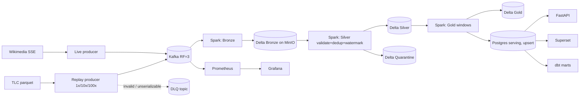

# DEVELOPMENT.md — Real-Time Mobility Intelligence Platform

Status log. Updated after every phase. Nothing is marked done unless it was executed and verified.

## 0. Environment inspection (2026-11-15)

| Item | Finding | Consequence |
|---|---|---|
| Hardware | Apple M1 Pro, 10 cores, 16 GB RAM, 76 GB free disk | Everything must be arm64-compatible |
| Docker | Docker Desktop 24.0.5 / Compose v2.20.2, VM = **5 CPUs / 8 GB** | Full stack does not fit in 8 GB -> Compose **profiles** |
| Java | none on host | Spark runs in containers only; no host `brew install` |
| Python | host 3.10.8; `uv` 0.11 available | Host venv via `uv` (3.12) for unit tests; Spark tests run in container |
| Network | TLC CloudFront, Wikimedia SSE, Citi Bike GBFS all reachable | Real data, real live feed |

## 1. Dataset discovery

Verified on 2026-11-15 by HTTP request, not assumed.

| Candidate | Type | Verified | Format / size | Fit |
|---|---|---|---|---|
| **NYC TLC Yellow Taxi** — https://www.nyc.gov/site/tlc/about/tlc-trip-record-data.page | Historical (monthly, ~2 month lag) | `yellow_tripdata_2024-01.parquet` HTTP 200, 49.9 MB | Parquet, ~2.9M rows/month | Excellent: fares, distance, timestamps, zones, payment -> every DQ rule and Gold metric in scope |
| **NYC TLC Green Taxi** (same page) | Historical | `green_tripdata_2024-01.parquet` HTTP 200, 1.4 MB | Parquet | Same schema family (different column names: `lpep_*`) -> proves schema unification/evolution |
| **Taxi zone lookup** — https://d37ci6vzurychx.cloudfront.net/misc/taxi_zone_lookup.csv | Reference | HTTP 200, 12 KB | CSV | Zone/borough names for geo gold tables |
| **Wikimedia EventStreams `recentchange`** — https://stream.wikimedia.org/v2/stream/recentchange | **Genuinely live** SSE | Received events live (`dt` = 2026-11-15) | JSON over SSE, ~tens of events/s | Real live feed, but not mobility; used as the "live producer" to exercise real-time ingestion, reconnect and `Last-Event-ID` resume |
| **Citi Bike GBFS** — https://gbfs.citibikenyc.com/gbfs/en/station_status.json | **Genuinely live** (polled, not push) | HTTP 200, JSON | JSON snapshot, polled every ~60 s | Mobility-relevant live source (bike/dock availability). Optional second live producer |
| Citi Bike trip history `s3.amazonaws.com/tripdata/` | Historical | Guessed filename returned 404 | CSV zip | Rejected: no fares, so no revenue/DQ-on-money rules |

**License:** TLC states it did not create the data and makes no accuracy guarantees (data comes from TPEP/LPEP vendors). I did **not** find an explicit license text; the NYC Open Data metadata endpoint did not return one either. Treat as public NYC open data, attribute TLC, and re-check terms before any redistribution. Wikimedia event data is public; their API etiquette requires an identifying User-Agent and no hammering.

**Decision:** TLC Yellow + Green (replay) as the core dataset; Wikimedia `recentchange` as the live producer (push SSE, real reconnect semantics). TLC is *not* a live stream: it is replayed at 1x/10x/100x using each row's `tpep_pickup_datetime` as event time. Citi Bike GBFS is a stretch goal.

**Known data traps (will be exercised by DQ rules):** Yellow files contain out-of-range timestamps (e.g. 2002, 2008), negative fares, zero/huge distances, dropoff-before-pickup, nulls in `passenger_count`/`airport_fee`; columns were added in 2025 (`cbd_congestion_fee`) -> real schema evolution.

## 2. Architecture decisions and trade-offs

Resource budget (8 GB Docker VM) drives these:

| Decision | Choice | Trade-off |
|---|---|---|
| Kafka | 3-broker KRaft cluster (combined controller+broker, ~512 MB heap each) to genuinely demo broker failure; RF=3, `min.insync.replicas=2`. `KAFKA_PROFILE=single` gives 1 broker for low-memory machines | 3 brokers cost ~1.5 GB; single broker cannot demo failover |
| Schema | Avro + Confluent Schema Registry, BACKWARD compatibility | Avro in Spark needs `from_avro` + wire-format header stripping (5 bytes) — handled explicitly |
| Table format | Delta Lake (delta-spark) on MinIO via S3A | Delta on S3A has no atomic rename: safe only with a single writer per table. One streaming writer per table by design |
| Exactly-once | Claim only: Kafka -> Delta Bronze is at-least-once source + idempotent sink (Delta `txnAppId` via `foreachBatch`) = effectively-once. Demonstrated with a kill-and-restart test comparing row counts. Postgres serving sink uses upsert on a deterministic key | No cross-system transaction; effectively-once is per-sink, tested not asserted |
| Spark | 1 master + 1 worker (2 cores, ~2 GB), jobs as separate `spark-submit`s (bronze, silver, gold) | Three JVM drivers is expensive; may merge silver+gold behind a flag if memory forces it |
| Airflow | Compose profile `orchestration` (LocalExecutor, own Postgres DB) — batch backfill, compaction (`OPTIMIZE`/`VACUUM`), dbt runs | Not run concurrently with Superset on 8 GB |
| Superset | Compose profile `bi` | Same |
| dbt | `dbt-postgres` on Gold tables synced to Postgres (marts / DQ reports). dbt-spark on Delta is not used (Thrift server = more memory) | Honest scope: dbt covers the serving layer only |
| Observability | Prometheus + Grafana; Kafka JMX/`kafka-exporter` for lag; Spark `StreamingQueryListener` -> metrics; app metrics via `prometheus_client` | |

Data flow:

## 3. Implementation plan (vertical slice first)

| Phase | Scope | Exit criterion (must be demonstrated) |
|---|---|---|
| 1 | Repo scaffold, `uv` venv, compose core (Kafka KRaft x3, Schema Registry, Kafka UI, MinIO), Makefile, `.env.example` | `docker compose ps` all healthy; create topic RF=3 |
| 2 | **Vertical slice:** Avro schema -> replay producer (idempotent, acks=all) -> Spark Bronze -> Delta on MinIO -> row-count check | N events produced == N rows in Bronze |
| 3 | Silver: validation rules, quarantine, dedup w/ watermark, DQ score | Injected bad rows land in quarantine; duplicates dropped |
| 4 | Gold windows (tumbling/sliding), anomalies, Postgres upsert sink | Gold counts match batch recomputation from Silver |
| 5 | FastAPI + health/readiness + JSON logging | curl each endpoint |
| 6 | Prometheus/Grafana, lag exporter, dashboards | Panels show live data (screenshot) |
| 7 | Reliability drills: broker kill, Spark kill, checkpoint recovery, replay, graceful shutdown | Scripted drill, before/after counts |
| 8 | Airflow (backfill, compaction), dbt, Superset | DAG run succeeds; dbt test passes |
| 9 | Pytest: unit / integration / e2e / DQ / recovery / schema-compat; CI | Green locally and in GitHub Actions |
| 10 | Benchmarks, docs, interview Q&A | Numbers measured on this machine, not estimated |

## 4. Progress

- [x] Environment inspected
- [x] Dataset research and verification
- [x] Architecture + plan
- [x] Phase 1: scaffold + core stack (verified 2026-11-15, see section 5)
- [x] Phase 2: vertical slice producer -> Kafka -> Bronze Delta on MinIO (verified, section 5)
- [ ] Phase 3: Silver (validation, quarantine, dedup, DQ score)

## 5. Test results

**Phase 1 (executed, passing):**
- `make up` -> kafka-1/2/3, schema-registry, kafka-ui, minio all `Healthy` (`up --wait`).
- Topic `smoke.test` (6 partitions, RF=3): `min.insync.replicas=2`, leaders spread over brokers 1/2/3, ISR full.
- Produce with `acks=all` then consume from beginning: message round-tripped.
- Schema Registry `GET /config` -> `BACKWARD`; Kafka UI `/actuator/health` -> `UP`; MinIO `/minio/health/live` -> 200; buckets `lakehouse`, `checkpoints` exist (`mc ls`).
- Idle memory: brokers ~340 MB each, Kafka UI 286 MB, SR 251 MB, MinIO 204 MB = ~1.76 GB of the 8 GB VM.

**Phase 2 (executed, passing):**
- `pytest tests/unit`: 9 passed (deterministic event IDs, NaN/int-overflow handling, DLQ-bound rows, Avro round-trip, replay clock pacing with a fake clock).
- `make topics`: `trips.raw.v1` (6 partitions, RF=3, min ISR 2), `trips.dlq.v1` (3 partitions).
- `make produce SPEED=0 LIMIT=200000`: sent=200000 acked=200000 failed=0 dlq=0, 6.4 s (~31k events/s, single Python process, idempotent + acks=all + lz4). Schema registered as id 1.
- `make bronze` (availableNow) then `make verify-bronze`: **PASS** — Bronze rows 200000 == Kafka rows 200000 == distinct (topic,partition,offset) 200000 == distinct decoded event_id 200000 (yellow 196229, green 3771). 26 MiB in MinIO.
- Re-running `make bronze` against the same checkpoint added no rows (still PASS).

**Not yet demonstrated (do not read as claimed):** DLQ path on real data (the 200k slice are the earliest-sorted rows, none have null pickup; only unit-tested), mid-batch crash recovery, continuous (non-availableNow) trigger, replay at 1x/10x/100x wall-clock (only the clock math is unit-tested), duplicate re-ingestion.

## 6. Known limitations (so far)

- 8 GB Docker VM: Airflow and Superset run under separate profiles, not alongside the full streaming stack.
- TLC license text not located; attribution only.
- Wikimedia is live but not mobility data; it validates live-ingestion mechanics, not mobility analytics.
- **MinIO image:** upstream `minio/minio` and `quay.io/minio/minio` can no longer be pulled (access denied). Using `bitnamilegacy/minio:2025.7.23`: real MinIO but frozen, no security patches, and no web console (community console removed upstream). Inspect buckets with `mc`. Local dev only. Fallback if this disappears: SeaweedFS or RustFS (both pullable, S3-compatible).
- Docker VM left at 8 GB (no answer on raising it); plan unchanged.
- Spark jobs currently run `local[2]` in a one-shot container, not on a standalone master/worker; chosen to stay inside 8 GB. Horizontal-scaling story will be documented, not demonstrated, unless a cluster profile is added.
- Spark INFO logging is noisy at startup (log4j default applies before `setLogLevel`); cosmetic.
- TLC timestamps are NYC local wall-clock; stored as-is and interpreted as UTC (no DST conversion). Hour-of-day demand therefore equals NYC local hour.
- Partition key = event_id (uniform spread, no per-zone ordering). Keying by PULocationID would give locality but hot partitions (JFK/LGA).
- Bronze `txnVersion = batchId` idempotence holds only while the checkpoint exists; deleting a checkpoint without clearing the table would re-append.
