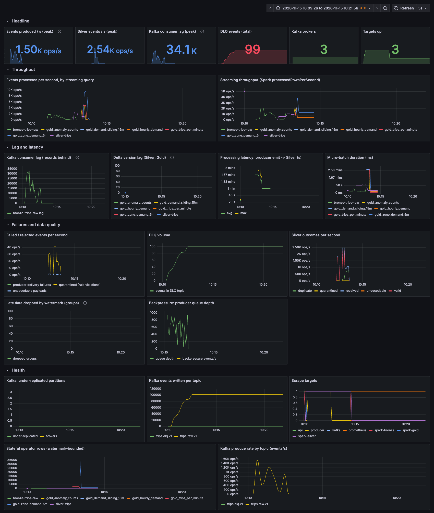
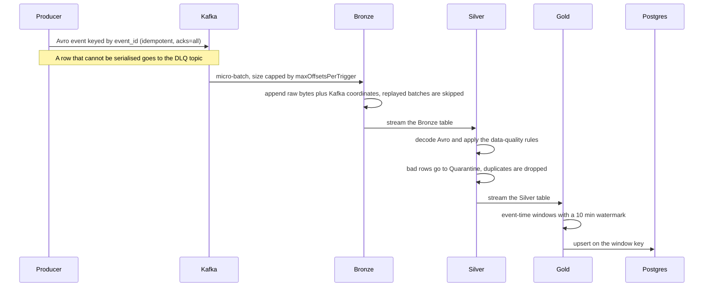
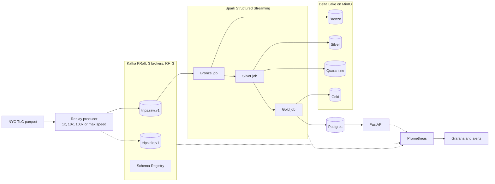
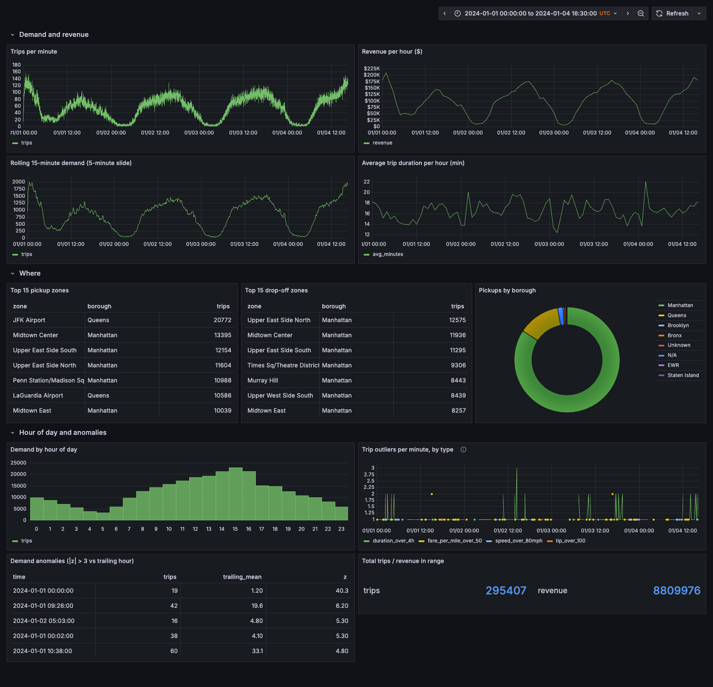
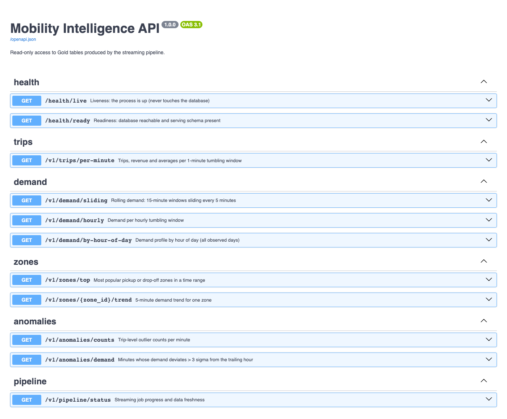
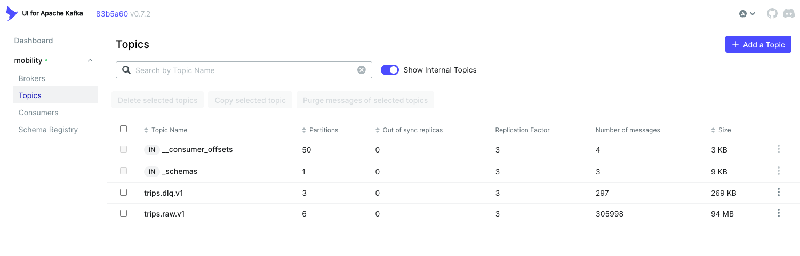
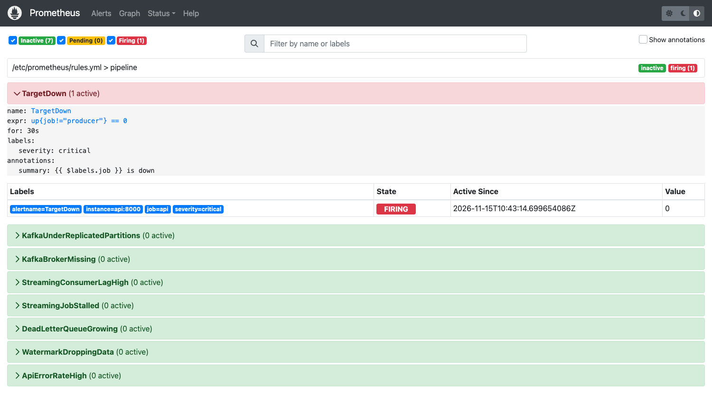

# Real-Time Mobility Intelligence Platform

A streaming data platform built on real NYC taxi trips. Trips are replayed into Kafka, cleaned and aggregated with Spark Structured Streaming into a Delta Lake (Bronze, Silver, Gold), served from Postgres through a FastAPI service, and monitored with Prometheus and Grafana.

The focus is on results you can check. Pipeline output is compared with independent oracles (plain Python that does not share code with Spark), and failures are injected on purpose to see whether the results stay correct.



**Contents:** [Data flow](#1-data-flow) · [System architecture](#2-system-architecture) · [Tech stack and why](#3-tech-stack-and-why) · [Quick start](#4-quick-start) · [What was verified](#5-what-was-verified) · [Screenshots](#screenshots) · [Limitations](#6-limitations) · [Repository layout](#7-repository-layout)

---

## 1. Data flow



| Layer | What it holds | Why |
|---|---|---|
| **Bronze** | The exact Kafka bytes plus topic, partition and offset | An immutable source of truth. Silver and Gold can be rebuilt from it |
| **Silver** | Decoded, validated, de-duplicated trips with a quality score | One trusted row per event |
| **Quarantine** | Rejected rows with the reason and the original bytes | Nothing is silently dropped |
| **Gold** | Five aggregates: trips per minute, 15 min sliding demand, zone demand, hourly demand, anomaly counts | Business metrics, written to Delta and to Postgres |

## 2. System architecture



Key design choices:

- **Effectively-once per sink, not end-to-end exactly-once.** Kafka delivers at-least-once, and every sink is idempotent: Delta transaction IDs for Bronze, `MERGE` on `event_id` for Silver, upserts for Gold and Postgres. No transaction spans Kafka, Delta and Postgres, so I do not claim more. The failure drills check this instead of asserting it.
- **One Spark job per layer.** A problem in one layer does not stop the others, and each can be restarted on its own.
- **One writer per Delta table.** Delta on S3-style storage has no atomic rename, so concurrent writers are unsafe.
- **Late data:** events later than the watermark are dropped from streaming Gold and counted in metrics. A batch job to repair them is not built.

## 3. Tech stack and why

| Technology | Role | Why this one |
|---|---|---|
| **Kafka** (KRaft, 3 brokers, RF=3, min ISR 2) | Event log | A real cluster is the only way to demonstrate a broker failure. `acks=all` plus an idempotent producer prevents loss and duplicates on send |
| **Avro + Schema Registry** | Event format | Enforces a schema and checks compatibility (BACKWARD) before a producer can change it |
| **Spark Structured Streaming** (PySpark) | Processing | Event-time windows, watermarks, checkpointing and built-in Delta and Kafka connectors |
| **Delta Lake** | Table format | ACID commits, `MERGE` for dedup and upserts, and transaction IDs that make retried writes safe |
| **MinIO** | Object storage | S3-compatible storage that runs locally |
| **Postgres** | Serving store | Simple upserts and indexed reads for the API, with a read-only role for the service |
| **FastAPI** | API | Typed, validated endpoints with automatic OpenAPI docs, health and readiness checks, and JSON logs |
| **Prometheus + Grafana** | Observability | Metrics, 8 alert rules, and dashboards generated from code so they stay reproducible |
| **Docker Compose** | Environment | One command brings up the stack. Profiles keep it inside an 8 GB Docker VM |
| **pytest + GitHub Actions** | Testing and CI | Unit, API, Spark and oracle tests, and a CI pipeline that runs them |

## 4. Quick start

Needs Docker (VM with 8 GB RAM and 5 CPUs), `uv`, Python 3.12 and `curl`. Tested on Apple silicon.

```bash
cp .env.example .env                       # local-dev defaults only
uv venv --python 3.12 && uv pip install -r requirements.txt
make data                                  # NYC TLC Jan 2024 sample (~50 MB)
make spark-image                           # Spark + Delta + Kafka jars
make up                                    # Kafka x3, Schema Registry, MinIO, Postgres, Kafka UI
make topics                                # create the topics
make monitoring-up                         # Prometheus, Grafana, API
make streaming-up                          # Bronze, Silver, Gold jobs
make produce SPEED=0 LIMIT=100000          # SPEED=1 is real time, 0 is as fast as possible
```

| Service | URL |
|---|---|
| Grafana (admin / `admin`) | http://localhost:3000 |
| Prometheus | http://localhost:9090 |
| API docs | http://localhost:8000/docs |
| Kafka UI (stopped while Spark jobs run, to save memory) | http://localhost:8080 |

Tests: `make test`, `make test-api`, `make test-spark`, `make e2e-silver`. Reliability drills: `make drill-broker`, `make drill-sigkill` and others. Drills reset the data, so use them locally only.

## 5. What was verified

| Check | Result |
|---|---|
| Nothing lost from Kafka to Bronze | Bronze rows equal Kafka rows (200,000) |
| Data-quality rules and dedup | 300k events with injected duplicates, garbage bytes and null timestamps match the oracle exactly |
| Gold aggregates | Delta equals Postgres equals a batch recompute, and an oracle built from the raw parquet agrees |
| Failure handling | Six drills, all passed, listed below |
| Tests | 9 unit, 29 API, 46 Spark, all green in GitHub Actions |

| Failure drill | What happens | Result |
|---|---|---|
| Broker down | `kafka-2` stopped for about 45 s under load | No data lost, cluster back in sync after 28.5 s, Silver and Gold exact |
| Spark jobs killed | Each job's JVM killed in turn under load | Compose restarted all three on its own in 12-17 s, results exact |
| Crash after write | Process dies after the Delta write, before the offset commit | No duplicates. A control run with the protection off created 19,997 duplicates, so the test can catch the failure |
| Graceful shutdown | `docker stop` during a batch | Exit code 0 (it was 143), in-flight batch finishes |
| Cold start | Downstream job starts before its table exists | Waits and recovers (a real bug, now fixed) |
| Producer | Overload and SIGTERM | 60k sent and acked, 0 lost, SIGTERM flushes cleanly |

Measured on one laptop (single run each): the producer reaches about 31,000 events/s, and Silver processes about 1,000 events/s, which makes it the bottleneck under a fast replay.

Full results, the 8 bugs these drills exposed, and scaling notes: [docs/reliability.md](docs/reliability.md). Dashboards and alerts: [docs/observability.md](docs/observability.md). Data quality report: [docs/dq_report.md](docs/dq_report.md). Common problems: [docs/troubleshooting.md](docs/troubleshooting.md). Build log: [DEVELOPMENT.md](DEVELOPMENT.md).

## Screenshots

| | |
|---|---|
|  **Demand dashboard (Gold data)** |  **API (OpenAPI docs)** |
|  **Kafka topics (Kafka UI)** |  **A real alert firing (Prometheus)** |

More images and what each panel shows: [docs/observability.md](docs/observability.md).

## 6. Limitations

- **Not built:** Airflow, dbt, Superset, a live data producer, table compaction, and the batch job that repairs late data.
- **Throughput:** one small Spark driver per layer (about 1,000 events/s). Scaling out is described in the docs but not demonstrated.
- **Not tested:** losing two brokers, MinIO or Postgres failure, and deleting a checkpoint while keeping the table.
- **Alerting:** alerts show in Prometheus and Grafana only, with no Alertmanager.
- **Local-dev security:** default passwords, and no authentication or TLS on the API.

## 7. Repository layout

```
producers/        replay producer, fault injectors, dead-letter queue
schemas/          Avro schema
spark_jobs/       Bronze, Silver and Gold jobs, data-quality rules, aggregates, sinks, verifiers
api/              FastAPI service
infrastructure/   docker-compose, Spark image, Postgres schema, helper scripts
monitoring/       Prometheus config and alert rules, Grafana provisioning
dashboards/       dashboard generator
tests/            unit, spark, integration, e2e oracles, recovery drills
docs/             reliability, observability, data quality, screenshots
```

Data: NYC Taxi & Limousine Commission trip records. TLC does not guarantee accuracy, and this repository does not include the data files.
