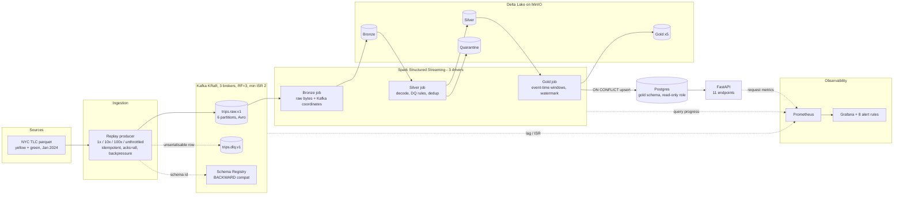

# Real-Time Mobility Intelligence Platform

A streaming data platform built on real NYC taxi trips: **Kafka → Spark Structured Streaming → Delta Lake (Bronze/Silver/Gold) on MinIO → Postgres → FastAPI**, with Prometheus/Grafana observability and a set of **scripted failure drills that verify the results against independent oracles**.

The emphasis is on correctness you can check, not on the number of tools: every claim below links to a test, a drill, or a measured number. Things that were *not* built or *not* proven are listed in [Limitations](#limitations).


## Contents
[Architecture](#architecture) · [Data flow](#data-flow) · [Design decisions](#design-decisions) · [Quick start](#quick-start) · [What was verified](#what-was-verified) · [Reliability drills](#reliability-drills) · [Measured performance](#measured-performance) · [Repository layout](#repository-layout) · [Limitations](#limitations) · [Troubleshooting](#troubleshooting)

## Architecture



## Data flow

```mermaid
sequenceDiagram
  participant P as Producer
  participant K as Kafka
  participant B as Bronze
  participant S as Silver
  participant G as Gold
  participant PG as Postgres
  P->>K: Avro event (key=event_id), acks=all, idempotent
  Note over P,K: row that cannot be serialised goes to trips.dlq.v1
  K->>B: micro-batch (maxOffsetsPerTrigger caps batch size)
  B->>B: append raw bytes + (topic,partition,offset); txnAppId/txnVersion=batchId, so a replayed batch is skipped
  B->>S: stream the Delta table
  S->>S: decode Avro, apply rule catalog
  S->>S: ERROR rule -> Quarantine (raw bytes kept); WARN -> DQ score -0.1
  S->>S: insert-only MERGE on event_id (drops in-batch and cross-batch duplicates)
  S->>G: stream the Silver table
  G->>G: windows on event time + watermark (10 min); late-beyond-watermark is dropped and counted
  G->>G: MERGE into Delta Gold (5 tables)
  G->>PG: INSERT ... ON CONFLICT DO UPDATE on the window key
```

| Layer | Content | Why it exists |
|---|---|---|
| **Bronze** | Exact Kafka bytes + topic/partition/offset/timestamp | Immutable, replayable source of truth; Silver/Gold can be rebuilt from it |
| **Silver** | Decoded, validated, de-duplicated trips with a DQ score | One trusted row per event; rejects are kept, not discarded |
| **Quarantine** | Rejected rows with the *reason* and the original bytes | Nothing is silently dropped; reprocessable after a rule fix |
| **Gold** | `trips_per_minute`, `demand_sliding_15m`, `zone_demand_5m`, `hourly_demand`, `anomaly_counts` | Business aggregates, written to Delta **and** Postgres |

## Design decisions

| Decision | Choice | Trade-off accepted |
|---|---|---|
| Delivery semantics | At-least-once source + **idempotent sinks** = effectively-once *per sink* | No cross-system transaction exists, so this is never claimed as end-to-end exactly-once. It is demonstrated by killing writers and comparing against oracles |
| Bronze idempotence | Delta `txnAppId` + `txnVersion = batchId` in `foreachBatch` | Only holds while the checkpoint exists. Deleting a checkpoint without clearing the table would re-append |
| Delta on S3A (MinIO) | Exactly one writer per table | S3A has no atomic rename. Scaling out means more partitions/tables, not more writers on one table |
| Dedup | Insert-only `MERGE` on `event_id` into Silver | Exact (checked against the oracle), but the merge cost grows with Silver size. A state-based dedup bounded by the watermark would be cheaper; it was not built or compared |
| Late data | 10 min watermark, bounded state; later events are dropped from streaming Gold and *counted* | Repair is a batch recompute of the affected windows. That job is **not implemented** |
| Schema | Avro + Schema Registry (BACKWARD), 5-byte wire header stripped for `from_avro` | Needs explicit header handling in Spark |
| Partition key | `event_id` | Uniform spread, but no per-zone ordering (keying by zone gives hot partitions: JFK/LGA) |
| Kafka | 3 KRaft brokers, RF=3, min ISR 2, `acks=all` | ~1.5 GB of the 8 GB VM, but it is the only way to demonstrate a broker failure |
| Spark | Three separate `local[2]` drivers, one per layer | A failure in one layer does not stop the others. Costs ~1.3-1.8 GB each, and throughput is bounded (~1k events/s for Silver) |
| Serving | Postgres upsert + read-only DB role + bounded connection wait | Not a real OLAP store; fine at this scale |

## Quick start

Requirements: Docker (VM with **8 GB** RAM, 5 CPUs), `uv`, Python 3.12, `curl`. Tested on Apple silicon (arm64).

```bash
cp .env.example .env                 # local-dev defaults only
uv venv --python 3.12 && uv pip install -r requirements.txt
make data                            # NYC TLC Jan-2024 yellow/green + zone lookup (~50 MB)
make spark-image                     # Spark 3.5.3 + Delta 3.2.1 + Kafka/Avro/S3A jars
make up                              # Kafka x3, Schema Registry, Kafka UI, MinIO, Postgres
make topics                          # trips.raw.v1 (6 partitions, RF=3), trips.dlq.v1
make monitoring-up                   # kafka-exporter, Prometheus, Grafana, API
make streaming-up                    # Bronze/Silver/Gold drivers (stops Kafka UI to save RAM)

make produce SPEED=0 LIMIT=100000    # SPEED=1 real time, 10, 100; 0 = as fast as possible
```

| Service | URL |
|---|---|
| Grafana (admin / `GRAFANA_ADMIN_PASSWORD`) | http://localhost:3000 |
| Prometheus (targets, alerts) | http://localhost:9090 |
| API + OpenAPI | http://localhost:8000/docs |
| Kafka UI (stopped while streaming; `docker compose ... start kafka-ui`) | http://localhost:8080 |
| Postgres (host port) | `localhost:5433` — `make psql` |

```bash
curl -s "localhost:8000/v1/zones/top?limit=3"
curl -s "localhost:8000/v1/pipeline/status"
```

### Tests

```bash
make test            # 9 unit tests (host)
make test-api        # 29 API integration tests (real Postgres, real DDL, read-only role)
make test-spark      # Spark tests inside the image: DQ rules, Silver batch, Gold windows + late data, metrics, cold start
make e2e-silver      # 300k events with injected faults vs an independent plain-Python oracle
bash infrastructure/scripts/e2e_gold.sh   # Delta == Postgres == batch recompute == oracle
make obs-demo        # 65 live checks incl. every Grafana panel query
```

CI (`.github/workflows/ci.yml`) runs the unit, API-integration and Spark tests, validates the compose file and alert rules, and checks that the dashboards match their generator. The Docker drills need the full stack and are local-only.

## What was verified

Each phase was run end to end before the next began. Details and the bugs found along the way are in [DEVELOPMENT.md](DEVELOPMENT.md).

| Claim | Evidence |
|---|---|
| Nothing lost between Kafka and Bronze | Bronze rows == Kafka rows == distinct offsets == distinct event_ids (200,000) |
| DQ rules and dedup are correct | 300k events with injected duplicates (1 in 50), poison bytes (1 in 997), null pickups (1 in 1009): Silver rows, per-rule quarantine counts and dedup counts match a **plain-Python oracle that shares no code with Spark** |
| Gold is correct | Delta == Postgres == batch recompute from Silver for all 5 tables, and an oracle computed from the raw parquet agrees on 10 measures |
| Late data behaves as designed | Test on real job code and real Delta tables: within-watermark updates a window; beyond-watermark is dropped and visible in metrics |
| API is safe and correct | 29 integration tests (including SQL-injection attempts and DB-down behaviour) and an oracle comparison of every endpoint |
| Dashboards show real data | All 47 panel queries return data through Grafana's own query API; an alert was fired and cleared on purpose |

Data-quality output for the sample: [docs/dq_report.md](docs/dq_report.md).

## Reliability drills

Run with `make drill-<name>` (they reset the lake, so local data only). Every drill ends by checking Silver and Gold against the independent oracles. Full evidence and the bugs these drills found: **[docs/reliability.md](docs/reliability.md)**.

| Drill | Fault | Result |
|---|---|---|
| `drill-producer` | Broker backpressure; SIGTERM mid-run | Passed: 60k sent = acked, 276 backpressure events, 0 failed; SIGTERM flushes and exits 0 |
| `drill-graceful` | `docker stop` of Silver mid-batch | Passed (9/9): exit code 0 (was 143), in-flight batch finished first |
| `drill-crash` | Process dies **after** the Delta write, **before** the offset commit | Passed (6/6): 100,000 rows, no duplicates. **Control with idempotence off:** 19,997 duplicate rows (one replayed batch), so the test can detect the failure it guards against |
| `drill-coldstart` | Silver/Gold started before upstream table exists | Passed; found and fixed a real cross-process bug |
| `drill-broker` | Stop `kafka-2` for ~45 s under a 100k-event replay | Passed (10/10): no message lost, ISR recovered in 28 s, Silver and Gold exact, Spark jobs unaffected |
| `drill-sigkill` | Kill the JVM of Bronze (t+20 s), Silver (t+70 s) and Gold (t+120 s) under load | Passed (7/7): compose restarted each driver itself (12–17 s to serve metrics); Silver and Gold exact against the oracles |

## Measured performance

One machine (M1 Pro, Docker VM 8 GB / 5 CPUs), one run each, no variance estimate.

| Measure | Value |
|---|---|
| Producer, unthrottled (idempotent, acks=all, lz4) | ~31,000 events/s |
| Bronze → Silver → Gold, three drivers, 1000x replay | ~815 events/s offered; Silver ~1,000 events/s processed at peak |
| Worst end-to-end latency (producer → Silver) | 82–111 s at the burst peak |
| Peak true Kafka lag | 26,871 records (broker outage), 68,497 (three Spark crashes), draining to 0 |

The latency and lag numbers show that a single `local[2]` Silver driver is the bottleneck, not Kafka. Scaling options are in [docs/reliability.md](docs/reliability.md#scaling-considerations).

## Repository layout

```
producers/        replay producer (TLC -> Avro -> Kafka), fault injectors, DLQ
schemas/          Avro schema (trip_event_v1.avsc)
spark_jobs/       bronze_stream, silver_stream, gold_stream, dq_rules, gold_aggregates, gold_sinks, metrics, verifiers
api/              FastAPI service (routers, db pool, schemas, metrics)
infrastructure/   docker-compose.yml, Spark image, Postgres DDL, topic + demo scripts
monitoring/       Prometheus config and alert rules, Grafana provisioning
dashboards/       dashboard generator (JSON is generated, not hand-edited)
tests/            unit, spark, integration, e2e (oracles), recovery (drills)
docs/             observability, DQ report, reliability, screenshots
```

## Limitations

Stated plainly, because they matter more than the features:

- **Not built:** Airflow, dbt, Superset, a live (Wikimedia) producer, compaction (`OPTIMIZE`/`VACUUM`), and the batch repair job for late data. Delta tables are small-file heavy.
- **Throughput:** one `local[2]` driver per layer, ~1k events/s. Horizontal scaling (Spark cluster, more partitions) is described in the docs, **not demonstrated**.
- **Delivery guarantee:** effectively-once *per sink*. There is no cross-system transaction.
- **Late data** beyond the 10 min watermark is dropped from streaming Gold. Spark's drop counter counts groups, not events (a lower bound).
- **Not tested:** loss of two brokers (KRaft quorum), MinIO or Postgres failure, deleting a checkpoint while keeping the table.
- **Alerting:** no Alertmanager. Alerts are visible in Prometheus and Grafana only.
- **Local-dev security:** default passwords, no TLS or auth on the API, `bitnamilegacy/minio` (a frozen image: upstream images can no longer be pulled).
- **Data:** TLC timestamps are NYC local time stored as-is and read as UTC. TLC license text was not located; attribution only (data from the NYC Taxi & Limousine Commission).

## Troubleshooting

| Symptom | Cause / fix |
|---|---|
| Containers exit with code 137 or Spark jobs hang | Docker VM is out of memory. Use an 8 GB VM, keep Kafka UI stopped while the three drivers run |
| `make verify-*` or a drill times out | Do not run a fourth Spark JVM next to three live drivers; stop the streaming services first (the drills do this) |
| `docker kill` does not restart a Spark service | Docker never applies restart policies to a manual kill. A crash does restart it (`restart: on-failure`) |
| Silver/Gold wait forever at start | They wait for the upstream Delta table (`WAITING_FOR_UPSTREAM` in the log). Start Bronze and produce data |
| API returns 503 | Postgres unreachable or connection pool timeout. `/health/live` stays 200, `/health/ready` is 503 |
| `Postgres not reachable on localhost:5433` in tests | Start the stack (`make up`) or let CI's service container provide it |
| Docker build cannot reach PyPI | The API image uses vendored dependencies: run `make api-vendor` first |
| Reset everything | `bash infrastructure/scripts/reset_data.sh` (**deletes** topics, lakehouse, checkpoints and gold tables) |

## Data and license

NYC TLC Trip Record Data, from the NYC Taxi & Limousine Commission. TLC does not guarantee accuracy. Re-check TLC's terms before redistributing any data. This repository does not include the data files.
