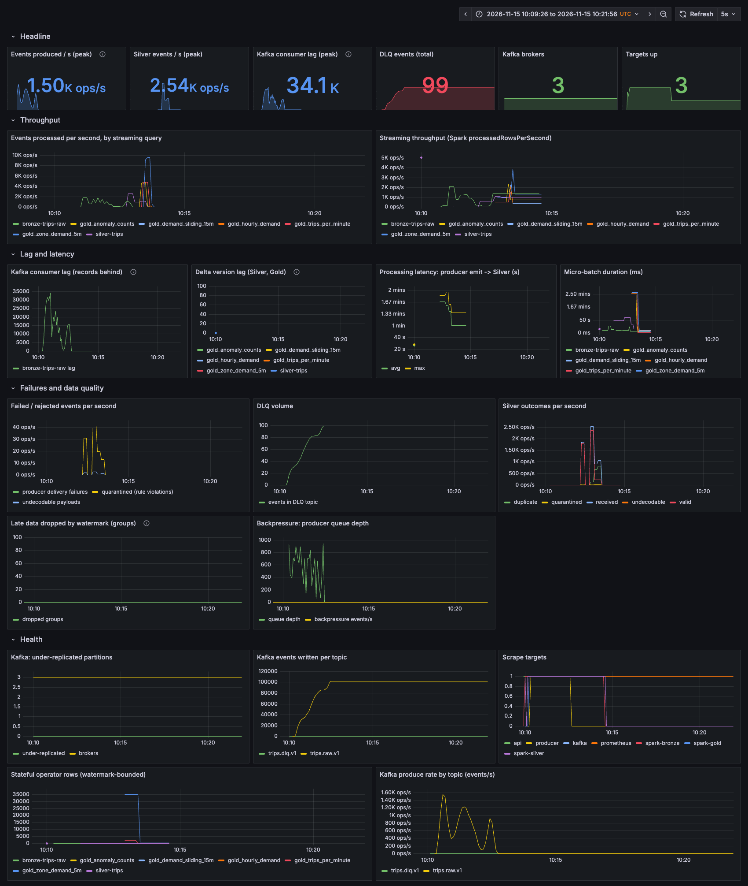
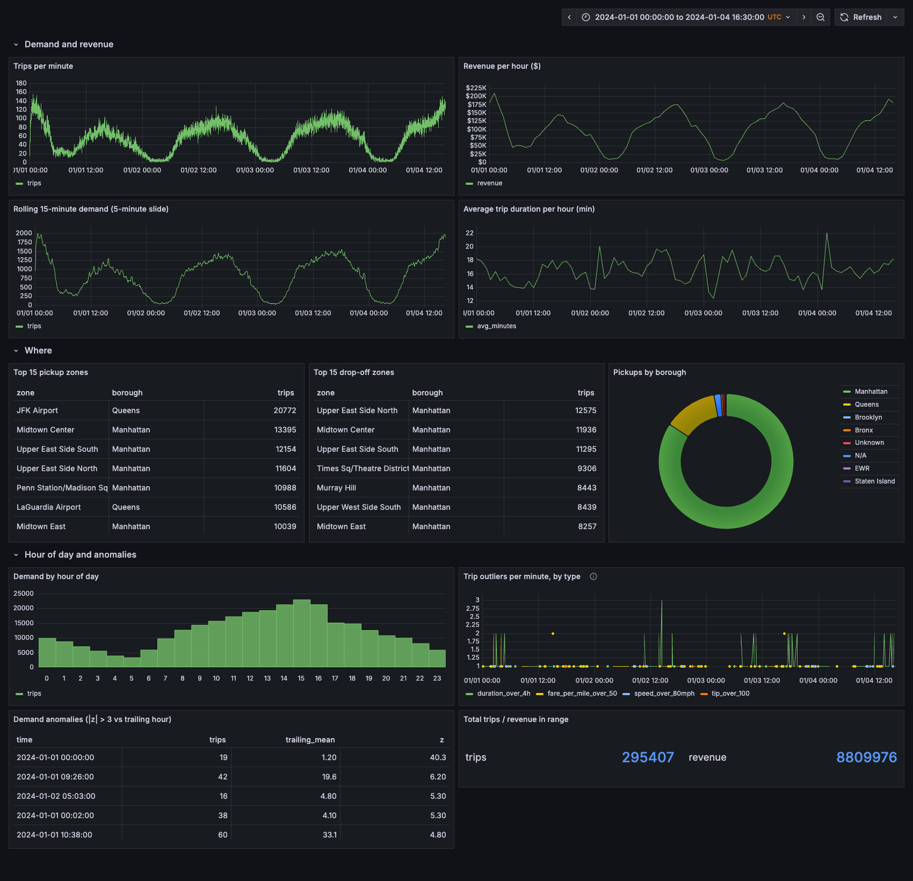
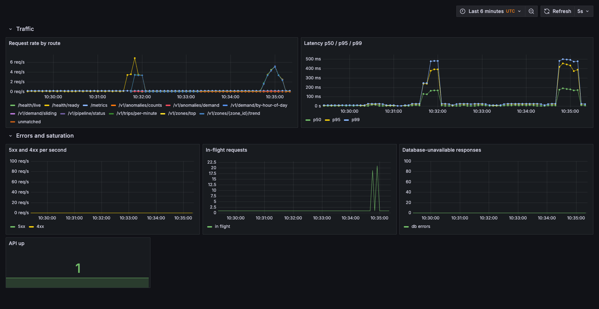
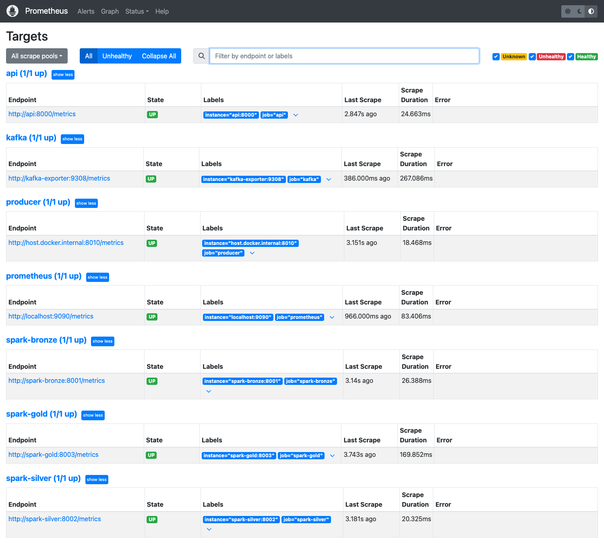
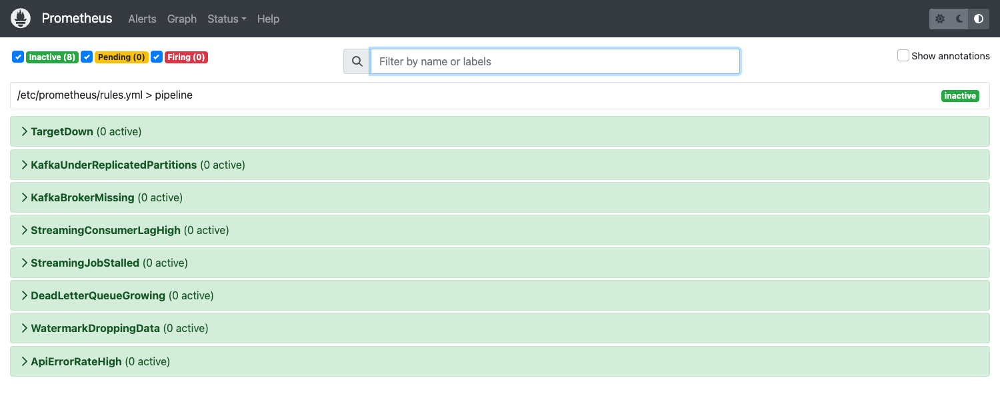
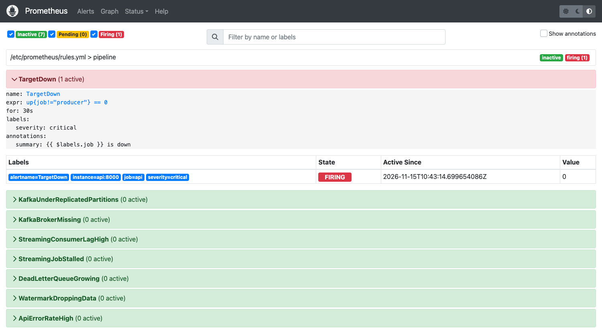
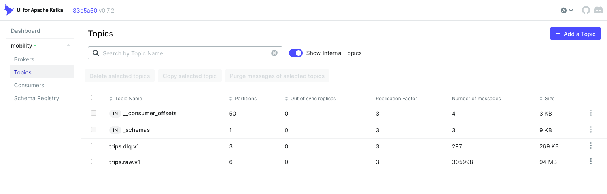
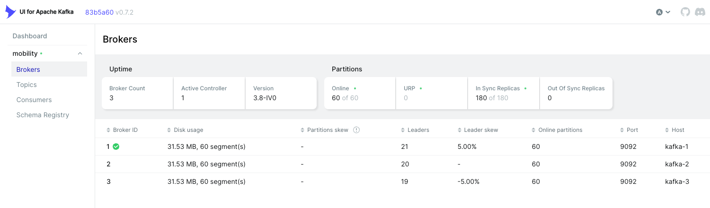
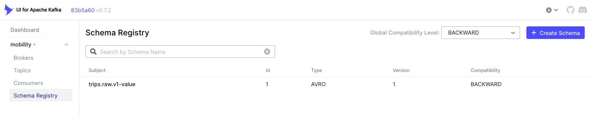
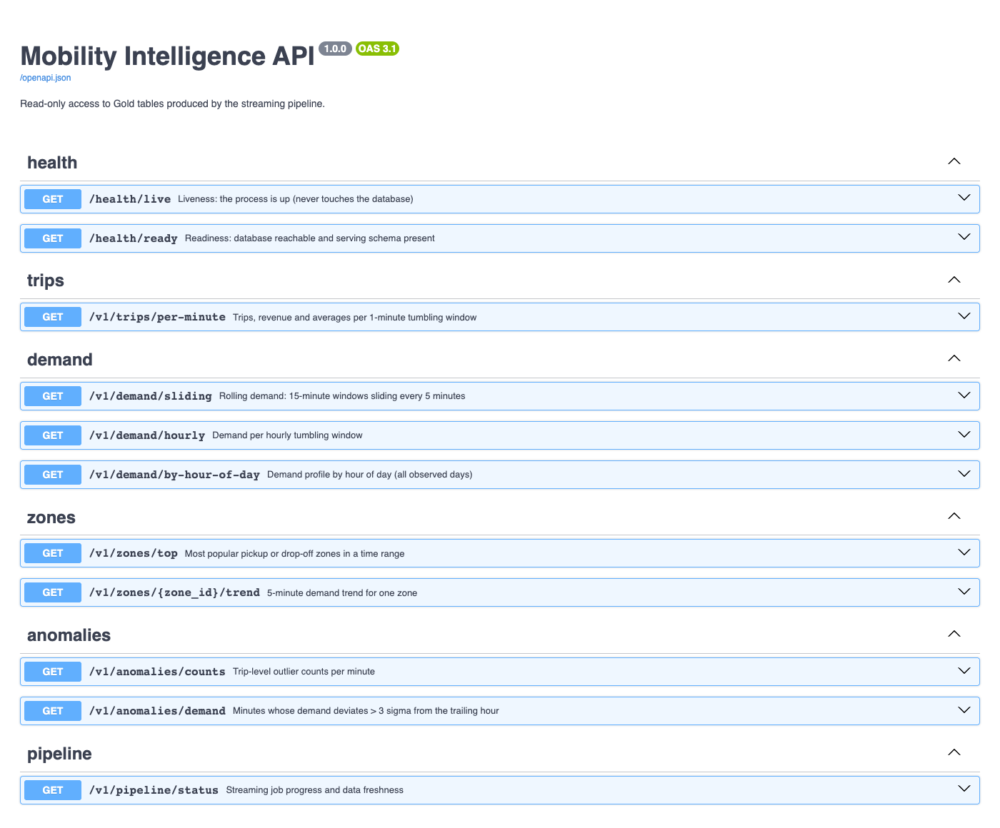

# Observability

Stack: **Prometheus** (scrape 5 s, 7 d retention) -> **Grafana** (provisioned from code) + **kafka-exporter** + app metrics
(API, Spark drivers, replay producer). Everything is defined in `monitoring/` and `dashboards/`; nothing is click-configured.

| What | URL | Notes |
|---|---|---|
| Grafana | http://localhost:3000 | `admin` / `admin` (dev default, set `GRAFANA_ADMIN_PASSWORD`). Home = Pipeline Overview |
| Prometheus | http://localhost:9090 | `/targets`, `/alerts`, `/rules` |
| API metrics | http://localhost:8000/metrics | route-template labels (no cardinality blow-up) |
| Spark drivers | `spark-bronze:8001`, `spark-silver:8002`, `spark-gold:8003` | scraped inside the compose network |
| Replay producer | `host.docker.internal:8010` | only while a replay runs; short linger at the end |

## Run it

```bash
make monitoring-up              # prometheus, grafana, kafka-exporter, api
make streaming-up               # Bronze/Silver/Gold as long-running services (stops Kafka UI to save RAM)
make produce SPEED=1000 LIMIT=100000      # exposes producer metrics on :8010
make obs-check                  # executes every dashboard panel through Grafana and checks targets/rules
make obs-demo                   # the whole thing from a clean reset, incl. ground-truth cross-checks
make streaming-down
```

## Dashboards (Grafana -> Dashboards -> Mobility)

| Dashboard | Source | Panels (all verified to return data) |
|---|---|---|
| **Pipeline Overview** | Prometheus | events produced/s, events processed/s per layer, streaming throughput, **true Kafka consumer lag**, Delta version lag, **producer->Silver latency** (avg/max), micro-batch duration, failed/rejected events/s, **DLQ volume**, Silver outcomes/s, watermark drops, backpressure/queue depth, broker count & under-replicated partitions, topic end offsets, scrape targets, stateful-operator rows |
| **API** | Prometheus | request rate per route, p50/p95/p99 latency, 5xx/4xx, in-flight, DB-unavailable responses, up |
| **Mobility Demand (Gold)** | Postgres (read-only role) | trips per minute, revenue per hour, rolling 15-min demand, avg trip duration, top pickup/drop-off zones, pickups by borough, demand by hour of day, outlier counts by type, demand anomalies (|z|>3), totals. **Default time range is 2024-01-01..05 (the replayed data), not "now"** |

Regenerate after editing `dashboards/build_dashboards.py`: `make dashboards` (Grafana reloads provisioned files within ~10 s).

## Reading the lag panels (important)

Structured Streaming keeps offsets in its checkpoint and **never commits to a Kafka consumer group**, so group-lag
exporters show nothing for Spark. True lag is therefore computed in Prometheus:

    sum(kafka_topic_partition_current_offset{topic="trips.raw.v1"}) - sum(spark_kafka_processed_offset_sum{topic="trips.raw.v1"})

(broker log-end offset from kafka-exporter, minus the offset Bronze has processed). `spark_kafka_lag_records` (Spark's
own latest-minus-end offset) is *planning-time* lag and reads ~0 unless `maxOffsetsPerTrigger` throttles, it is kept only
for that case. Measured: a 150k-event burst gave a true-lag peak of 76,935 records draining to 0, while the planning-time
gauge stayed at 0. Delta-source lag is "table versions behind" (`spark_delta_version_lag`).

## Alerts (`monitoring/prometheus/rules.yml`, validated with `promtool`)

`TargetDown`, `KafkaUnderReplicatedPartitions`, `KafkaBrokerMissing`, `StreamingConsumerLagHigh`, `StreamingJobStalled`,
`DeadLetterQueueGrowing`, `WatermarkDroppingData`, `ApiErrorRateHigh`. No Alertmanager is deployed (state is visible in
Prometheus/Grafana only). Demonstrated: stopping the API fired `TargetDown` in 31 s and it cleared 7 s after restart;
`WatermarkDroppingData` fired on its own during the late-data replay (a true positive).

## Metric catalogue (own metrics)

Spark (per `query`): `spark_input_rows_total`, `spark_processed_rows_per_second`, `spark_batch_duration_ms`,
`spark_state_rows`, `spark_dropped_by_watermark_groups_total` (a lower bound on lost events: counts groups, not events),
`spark_kafka_processed_offset_sum`, `spark_delta_version_lag`, `spark_last_batch_timestamp_seconds`; Silver only:
`spark_silver_rows_total{outcome=received|valid|quarantined|undecodable|duplicate}`, `spark_silver_latency_seconds{stat}`.
Producer: `producer_events_{sent,acked,failed}_total`, `producer_dlq_events_total`, `producer_backpressure_events_total`,
`producer_queue_depth`, `producer_running`. API: `api_http_requests_total`, `api_http_request_duration_seconds`,
`api_http_requests_in_flight`, `api_db_errors_total`.

## Screenshots

All captured from the running stack by `tools/screenshots/capture.mjs` (Playwright driving the locally installed
Google Chrome; no browser download). They are real renders of the live system, not mock-ups.

### Pipeline Overview (Grafana)
Window = a live run of 102,000 events replayed at 1000x with injected late, duplicate, garbage and null-pickup events.
Headline stats show the **peak** over the range. Note the true-lag spike (~34k records) draining to 0, the DLQ at 99,
Silver batches falling behind the 5 s trigger, and the producer/spark targets appearing and disappearing in "Scrape targets".



### Mobility Demand (Grafana, from Postgres Gold)
300k replayed trips (Jan 1-4, 2024). Daily demand cycle, JFK as the top pickup zone, the New-Year-midnight demand anomaly
(z = 40.3) at the top of the anomaly table. The range ends at 16:30 on Jan 4 to exclude the partial last minute where the
sample was cut off (otherwise it shows up as a false "anomaly").



### API dashboard (Grafana)
Two bursts of the 400-request / 20-thread load smoke: request rate per route, p50/p95/p99, in-flight peak ~20.



### Prometheus: all 7 targets up, alerts, and one firing


`TargetDown` really firing: the API container was stopped, the alert fired after 33 s, and it cleared after restart.


### Kafka (Kafka UI) and the API
Three brokers all in sync (60/60 partitions online, 0 under-replicated), `trips.raw.v1` with 305,998 messages at
replication factor 3, the DLQ with 297, and the Avro schema registered with BACKWARD compatibility.






### Re-taking them
```bash
make monitoring-up && make streaming-up          # streaming-up stops Kafka UI to save RAM; start it again later
make produce SPEED=100 LIMIT=40000               # keeps the producer target up while you capture
cd tools/screenshots && node capture.mjs         # or: --only grafana-api,prometheus-targets
PIPELINE_WINDOW_JSON=window.json node capture.mjs --only grafana-pipeline-overview   # {"from_ms":..,"to_ms":..} of a past run
```
Gotchas learnt while doing this: capture Prometheus pages while everything is *running* (a stopped Spark job shows up as DOWN
and `TargetDown` fires); stat panels show the last value by default, so a finished run reads 0 (hence the "peak" stats);
crop heights in `capture.mjs` are tuned to the content, so re-check them if you add panels.
